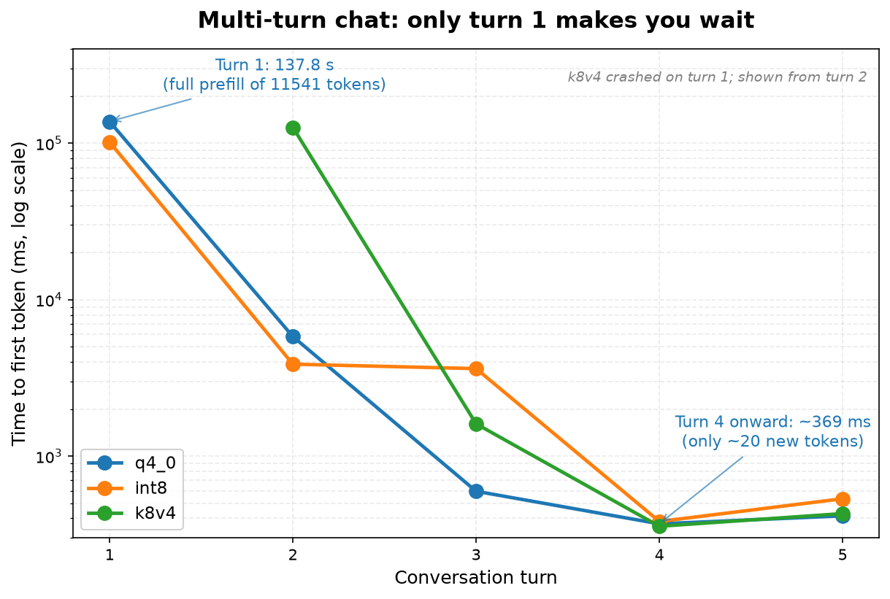
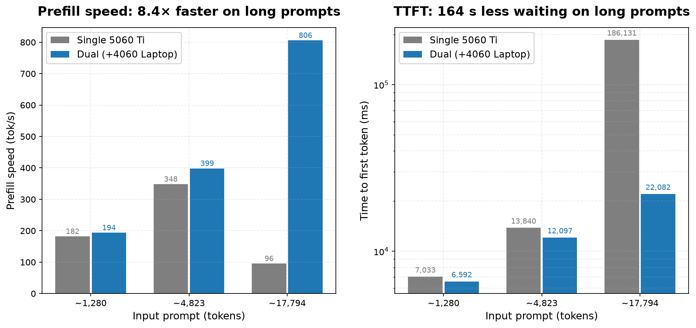
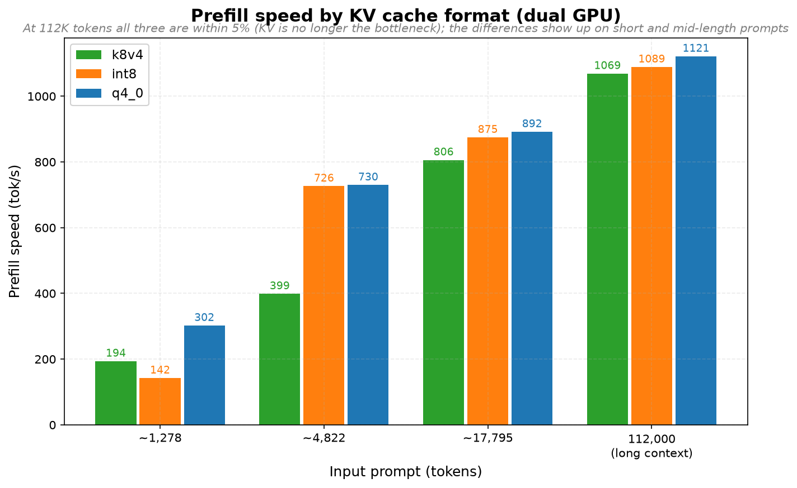
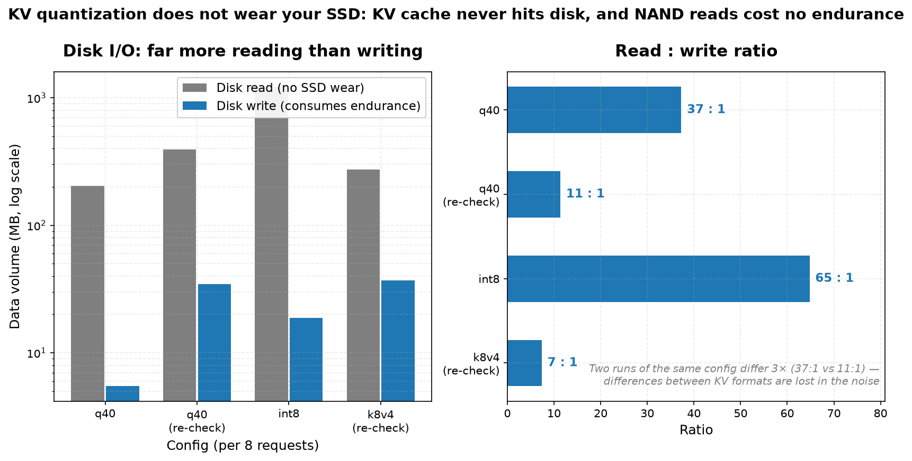

[简体中文](README.md) | English

# Benchmarking a Local LLM: I Had to Throw Away My Own Results Twice

Four rounds of systematic benchmarking of **Qwen3.8-Flash-Next Q2_0** (a 62 GB MoE model) running on
**Strata** (engine 0.1.41) on a 32 GB laptop.

The real point of this repo is not the numbers — it's **how easily you can fool yourself when measuring**.
My first two methodologies were both wrong.

---

## TL;DR: six findings

| # | Finding | Key number |
|---|---|---|
| 1 | **Single measurements are worthless** | Prefill for the *same* prompt ranged from 77.8 to 625.6 tok/s — an **8× spread** |
| 2 | **Prompt cache silently poisons benchmarks** | Repeating a prompt dropped `prompt_n` from **1259 to 5** — I was measuring cache hits, not prefill |
| 3 | **Real chat ≠ cold start** | First turn TTFT **137.8 s**, turn 4 onward **0.4 s** (**330× faster**) |
| 4 | **Two GPUs beat one by 8.4×** on long prompts | 805.9 vs 95.6 tok/s prefill; TTFT 22 s vs 186 s |
| 5 | **KV quantization does not wear your SSD** | KV never touches disk; measured read:write ≈ **10–40 : 1** |
| 6 | **q4_0 is measurably worse on long documents** | perplexity **+8–12%** (needle tests still pass) |

---

## Hardware

| Item | Spec |
|---|---|
| Laptop | Clevo barebone `NP5x_6x_7x_SNx` |
| CPU | Intel Core i9-13900HX (24C/32T) |
| RAM | 32 GB DDR5-4800 (2×16 GB) |
| GPUs | RTX 5060 Ti 16 GB + RTX 4060 Laptop 8 GB |
| Storage | NVMe SSD |
| OS | Windows 11 |
| Model | Qwen3.8-Flash-Next Q2_0 (62 GB MoE) |
| Engine | Strata 0.1.41 |

---

## Core data

### 1. Multi-turn chat: KV cache reuse dominates everything

Roughly 11.5K tokens of technical material as the first turn, then five follow-up questions
(summarize → elaborate → code sample → table → answer again in English):

| Turn | Input tokens | Reused | Newly read | TTFT | decode |
|---|---|---|---|---|---|
| 1 | 11541 | 0 | 11541 | **137,771 ms** | 31.1 tok/s |
| 2 | 11630 | 11536 | 94 | 5,816 ms | 25.3 tok/s |
| 3 | 11650 | 11625 | 25 | 596 ms | 30.5 tok/s |
| 4 | 11663 | 11645 | 18 | **369 ms** | 32.3 tok/s |
| 5 | 11678 | 11658 | 20 | **415 ms** | 35.5 tok/s |



**Only turn 1 makes you wait.** The "long prompts take 100+ seconds" figure from cold-start
benchmarks does not describe normal conversation at all.

### 2. Single GPU vs dual GPU (both at 128K context, k8v4)

| prompt | metric | Single 5060 Ti | Dual (split) |
|---|---|---|---|
| ~17.8K tok | prefill | 95.6 tok/s | **805.9 tok/s** |
| | TTFT | 186,131 ms | **22,082 ms** |
| | decode | 54.2 tok/s | **69.4 tok/s** |



**Why**, straight from the engine log:

```
FileExpertSource: WARNING: 2517 of 2540 lendable slots (99%) will read their experts
                 from the pack during a long prompt
strata serve: stall report: stage "reading the prompt (batched), done up to token 17768" for 61 s
```

On a single card the prompt chunk is 8192 tokens, but there are only 6322 expert-cache slots.
Once the chunk borrows them, 99% of experts must stream from disk — a 61-second stall.

### 3. KV cache format comparison (dual GPU)

| prompt | k8v4 | int8 | q4_0 |
|---|---|---|---|
| ~1.3K prefill | 193.7 | 142.2 | **302.1** |
| ~4.8K prefill | 398.6 | 726.3 | **729.7** |
| ~17.8K prefill | 805.9 | 874.6 | **891.8** |
| 112K prefill | 1068.8 | 1088.8 | **1121.4** |
| available slots | 2355 | 2310 | **2401** |



**q4_0 wins on raw speed, but at a real cost** (see finding 6). At 112K tokens all three are
within 5% — the KV format stops being the bottleneck.

### 4. Disk I/O and SSD wear

Eight requests of 6233 tokens each (unique nonce forcing a full prefill every time):

| KV | Disk **read** | Disk **write** |
|---|---|---|
| q4_0 | 204 / 394 MB | **5.5 / 34.6 MB** |
| int8 | 1220 MB | **18.8 MB** |
| k8v4 | 273 MB | **36.9 MB** |



> The first k8v4 run reported 2153 MB written. **Re-running disproved it** — same config, 36.9 MB.
> External interference.

**KV cache never touches disk**, and NAND reads do not consume P/E cycles. At the measured write
volume, a 600 TBW SSD would take roughly **2,700 years** to wear out.

---

## Methodology: where I went wrong

This is arguably the most transferable part of the repo.

| Version | Approach | Fatal flaw |
|---|---|---|
| **v1** | one request per data point | 8× noise. My conclusion "single GPU is 51% faster on long prompts" was **simply wrong** |
| **v2** | 3 repeats, take the median | **Poisoned by prompt cache**: from the 2nd repeat, `prompt_n` fell from 1259 to 5 and TTFT from 6322 ms to 64 ms |
| **v3** ✅ | 3 repeats + **unique nonce per request** | Correct. The `CacheN` column in the CSV is 0 throughout — verifiable |

**Three lessons that generalize:**

1. **Any "run it once and see" LLM benchmark is untrustworthy.** Repeat and report the spread.
2. **Verify `cache_n == 0`**, or you are benchmarking cache hits.
3. **Re-check any single outlier.** That bogus 2153 MB nearly produced the headline
   "k8v4 wears your SSD 393× faster than q4_0".

---

## Repository layout

```
.
├── README.md                    # Chinese
├── README.en.md                 # this file
├── REPORT.md                    # full technical report (Chinese, 18 sections)
├── PUBLISH-X.md                 # ready-to-post X/Twitter threads
├── data/
│   ├── bench-results3.csv       # main benchmark (26 rows, CacheN always 0)
│   ├── bench-chat.csv           # multi-turn chat (5 turns × 3 KV formats)
│   ├── bench-ssd.csv            # disk I/O (5 runs, including re-checks)
│   └── bench-results-v1-archived.csv   # v1 data (flawed method, for contrast)
├── scripts/
│   ├── bench3-strata.ps1        # prefill/decode bench (nonce bypasses prompt cache)
│   ├── bench-chat.ps1           # multi-turn chat bench (mimics a real client)
│   └── bench-ssd.ps1            # disk read/write measurement
├── figures/                     # 4 charts, generated from the CSVs
├── make-figures.py              # matplotlib script (CJK font aware)
├── publish.ps1                  # one-shot publish helper
└── configs/                     # 7 engine configs (single/dual × KV × context)
```

---

## Reproducing

The scripts are PowerShell and target Windows:

```powershell
# 1. Prefill / decode: 3 repeats per point, unique nonce per request
.\scripts\bench3-strata.ps1 -Config <your-config.json> `
    -Label "my-run" -PromptChars 2000,8000,30000 -GenTokens 200 -Repeats 3

# 2. Multi-turn chat: sends accumulating messages, measures KV cache reuse
.\scripts\bench-chat.ps1 -Config <your-config.json> -Label "my-chat" -DocChars 20000

# 3. Disk I/O
.\scripts\bench-ssd.ps1 -Config <your-config.json> -Label "my-ssd" -Requests 8
```

**How to read the results:**

- `CacheN` must be 0, or the run was polluted by prompt cache.
- When the spread dwarfs the median, treat that data point as inconclusive.
- Startup time varies wildly with system state (measured 90.2 s – 501.3 s here) —
  **it is not a measure of config quality**.

> The paths in `configs/` are absolute paths from the author's machine (`D:\AI\Strata`).
> Adjust them for your own install before reproducing.

---

## Limitations

1. Only one model was tested (Q2_0); results may not transfer to other quantization levels.
2. No concurrency testing (multiple simultaneous requests).
3. No output-quality evaluation — this repo measures speed and precision metrics only.
4. Some data points had spreads above 100%. **Only differences larger than ~2× should be trusted.**
5. int8 startup is noticeably fragile: it needs 20.82 GiB resident RAM (vs 19.95 for q4_0) and
   took 316–444 s to become ready in testing.

---

## License

Data and scripts released under the MIT license. The model and engine are the property of their
respective authors.
