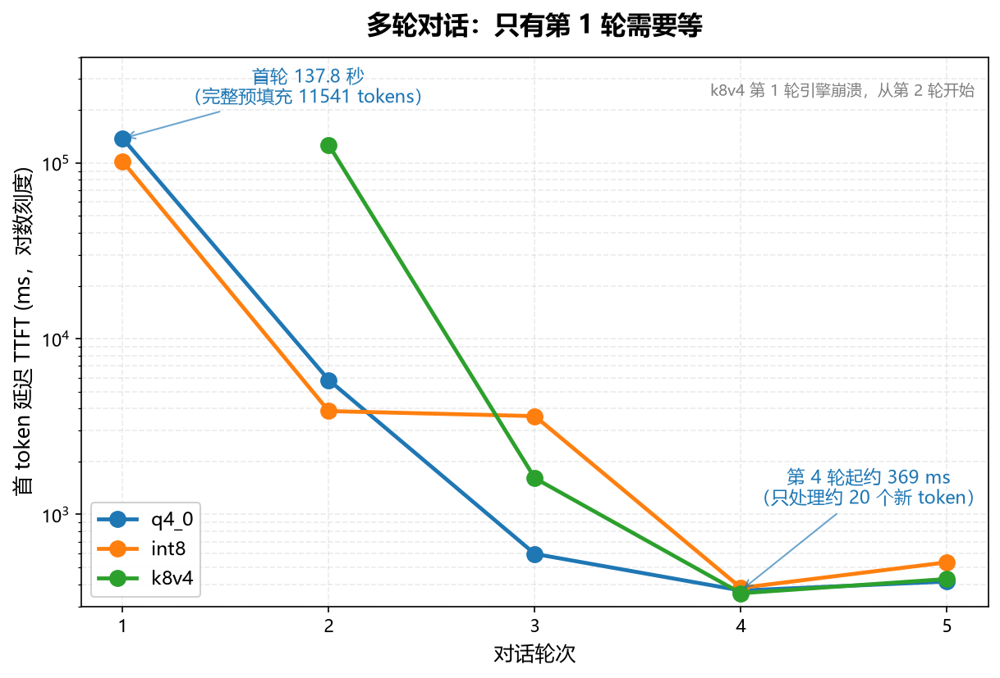
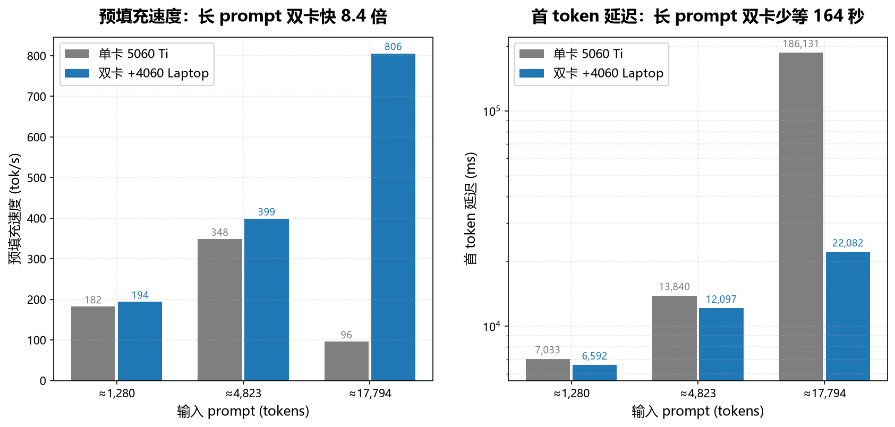
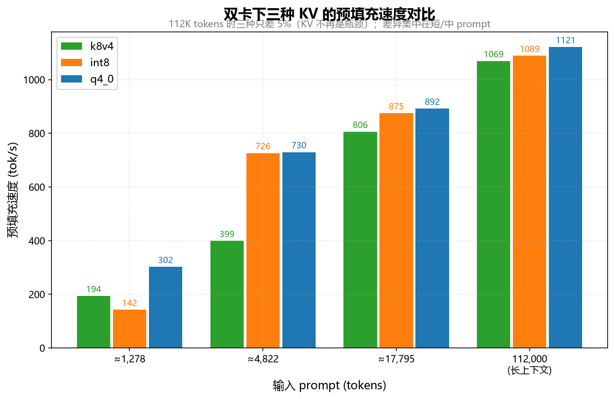
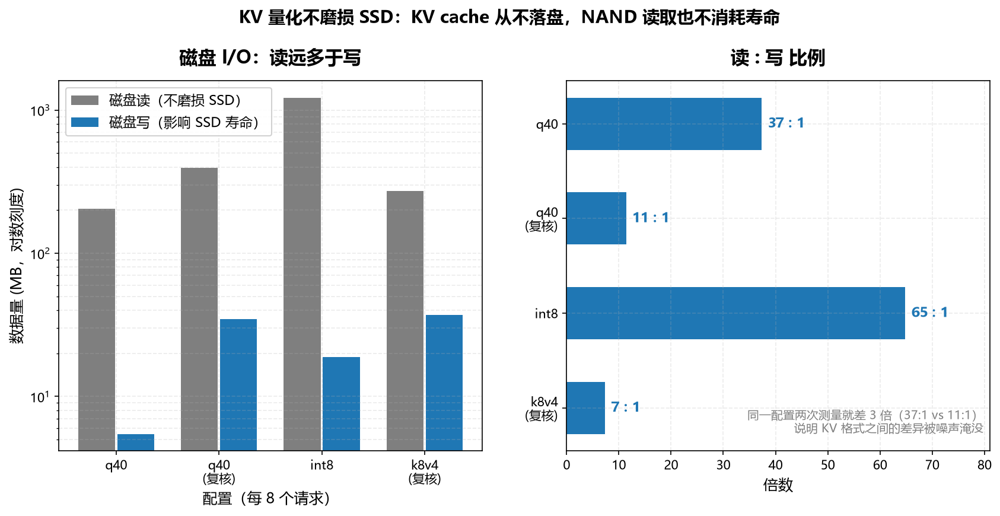

# 本地大模型基准测试：我推翻了自己两次

在一台 32 GB 内存的笔记本上，用 **Strata** 引擎（0.1.41）跑 **Qwen3.8-Flash-Next Q2_0**（62 GB MoE 模型），
做了四轮系统性的基准测试。

过程中**我的前两次方法论都是错的**——这份仓库的重点，其实是"怎么测才可信"。

---

## TL;DR：六个结论

| # | 结论 | 关键数字 |
|---|---|---|
| 1 | **单次测量完全不可信** | 同一 prompt 的 prefill 速度在 77.8 ~ 625.6 tok/s 之间摇摆（**8 倍**） |
| 2 | **prompt cache 会污染基准** | 重复同一 prompt 时 `prompt_n` 从 **1259 掉到 5**，测的是缓存命中而非预填充 |
| 3 | **真实对话 ≠ 冷启动** | 首轮 TTFT **137.8 秒**，第 4 轮起 **0.4 秒**（快 330 倍） |
| 4 | **双卡比单卡长 prompt 快 8.4 倍** | 805.9 vs 95.6 tok/s，TTFT 22 s vs 186 s |
| 5 | **KV 量化不磨损 SSD** | KV 从不落盘；实测读:写 ≈ **10–40 : 1** |
| 6 | **q4_0 长文档精度差** | perplexity **+8~12%**（needle 测试仍通过） |

---

## 硬件环境

| 项目 | 配置 |
|---|---|
| 机型 | Clevo 准系统 `NP5x_6x_7x_SNx` |
| CPU | Intel Core i9-13900HX（24 核 32 线程） |
| 内存 | 32 GB DDR5-4800（2×16 GB） |
| 显卡 | RTX 5060 Ti 16 GB + RTX 4060 Laptop 8 GB |
| 存储 | NVMe SSD |
| 系统 | Windows 11 |
| 模型 | Qwen3.8-Flash-Next Q2_0（62 GB，MoE） |
| 引擎 | Strata 0.1.41 |

---

## 核心数据

### 1. 多轮对话：KV cache 复用是决定性的




构造约 11.5K tokens 的技术材料作为首轮输入，连续追问 5 轮（总结 → 展开 → 代码 → 表格 → 英文重答）：

| 轮次 | 输入 tokens | 复用 | 新读 | TTFT | decode |
|---|---|---|---|---|---|
| 1 | 11541 | 0 | 11541 | **137,771 ms** | 31.1 tok/s |
| 2 | 11630 | 11536 | 94 | 5,816 ms | 25.3 tok/s |
| 3 | 11650 | 11625 | 25 | 596 ms | 30.5 tok/s |
| 4 | 11663 | 11645 | 18 | **369 ms** | 32.3 tok/s |
| 5 | 11678 | 11658 | 20 | **415 ms** | 35.5 tok/s |

**只有第 1 轮要等**。之前基准里"长 prompt 要等 100+ 秒"只适用于冷启动场景。

### 2. 单卡 vs 双卡（同为 128K 上下文、k8v4）




| prompt | 指标 | 单卡 5060 Ti | 双卡 split |
|---|---|---|---|
| ~17.8K tok | prefill | 95.6 tok/s | **805.9 tok/s** |
| | TTFT | 186,131 ms | **22,082 ms** |
| | decode | 54.2 tok/s | **69.4 tok/s** |

**原因**（日志原文）：

```
FileExpertSource: WARNING: 2517 of 2540 lendable slots (99%) will read their experts
                 from the pack during a long prompt
strata serve: stall report: stage "reading the prompt (batched), done up to token 17768" for 61 s
```

单卡的 prompt chunk 是 8192，但只有 6322 个 expert cache slots；借出去后 99% 的专家只能从磁盘读。

### 3. KV cache 格式对比（双卡）




| prompt | k8v4 | int8 | q4_0 |
|---|---|---|---|
| ~1.3K prefill | 193.7 | 142.2 | **302.1** |
| ~4.8K prefill | 398.6 | 726.3 | **729.7** |
| ~17.8K prefill | 805.9 | 874.6 | **891.8** |
| 112K prefill | 1068.8 | 1088.8 | **1121.4** |
| 可用 slots | 2355 | 2310 | **2401** |

**q4_0 综合最优，但它有一个明确的代价**（见下）。

### 4. 磁盘 I/O 与 SSD 磨损




8 个 6233-token 请求（nonce 强制完整预填充）：

| KV | 磁盘**读** | 磁盘**写** |
|---|---|---|
| q4_0 | 204 / 394 MB | **5.5 / 34.6 MB** |
| int8 | 1220 MB | **18.8 MB** |
| k8v4 | 273 MB | **36.9 MB** |

> k8v4 首次测出 2153 MB 写入，**复核证明是外部干扰**（同配置重测仅 36.9 MB）。

**KV cache 从不落盘**，且 NAND 读取不消耗 P/E 周期。按实测写入量级，
600 TBW 的 SSD 需要约 **2700 年**才会写满。

---

## 方法论：我错在哪（本节可能是最有价值的部分）

| 版本 | 做法 | 致命缺陷 |
|---|---|---|
| **v1** | 每个测点只请求 1 次 | 单次噪声达 8 倍，据此得出的"单卡长 prompt 快 51%"是**错误结论** |
| **v2** | 每测点重复 3 次取中位数 | **被 prompt cache 污染**：第 2 次起 `prompt_n` 从 1259 掉到 5，TTFT 从 6322 ms 掉到 64 ms |
| **v3** ✅ | 重复 3 次 + **每次插入唯一 nonce** | 正确。CSV 中 `CacheN` 列恒为 0，可验证 |

**三条可迁移的经验**：

1. **任何"跑一次看看"的本地模型测试都不可信**，必须重复测量并报告极差
2. **必须确认 `cache_n = 0`**，否则你测的是缓存命中
3. **任何单个异常数据点都要复核**——那个 2153 MB 的假数据差点让我得出"k8v4 磨损 SSD 是 q4_0 的 393 倍"

---

## 目录结构

```
.
├── README.md                    # 本文件
├── REPORT.md                    # 完整技术报告（18 节，含全部原始数据）
├── PUBLISH-X.md                 # X/Twitter 发布稿（含中文线程版）
├── data/
│   ├── bench-results3.csv       # 主基准数据（26 条，CacheN 恒为 0）
│   ├── bench-chat.csv           # 多轮对话数据（5 轮 × 3 种 KV）
│   ├── bench-ssd.csv            # 磁盘 I/O 数据（5 次测量，含复核）
│   └── bench-results-v1-archived.csv   # v1 数据（方法有缺陷，仅作对照）
├── scripts/
│   ├── bench3-strata.ps1        # 预填充/decode 基准（nonce 绕过 cache）
│   ├── bench-chat.ps1           # 多轮对话基准（模拟真实客户端）
│   └── bench-ssd.ps1            # 磁盘读写测量
├── figures/                     # 4 张配图（由 make-figures.py 从 CSV 生成）
├── make-figures.py              # 绘图脚本（matplotlib，中文字体）
└── configs/                     # 7 个引擎配置（单卡/双卡 × 各种 KV 与上下文）
```

---

## 复现

脚本为 PowerShell，Windows 环境：

```powershell
# 1. 预填充 / decode 基准：每测点重复 3 次，带唯一 nonce
.\scripts\bench3-strata.ps1 -Config <你的配置.json> `
    -Label "my-run" -PromptChars 2000,8000,30000 -GenTokens 200 -Repeats 3

# 2. 多轮对话：发送累积 messages，测量 KV cache 复用的效果
.\scripts\bench-chat.ps1 -Config <你的配置.json> -Label "my-chat" -DocChars 20000

# 3. 磁盘 I/O
.\scripts\bench-ssd.ps1 -Config <你的配置.json> -Label "my-ssd" -Requests 8
```

**判读要点**：

- `CacheN` 必须为 0，否则数据被 prompt cache 污染
- 极差远大于中位数时，该点位结论要保守
- 启动耗时受系统状态影响极大（实测 90.2 s ~ 501.3 s），**不是配置质量的指标**

> `configs/` 里的路径是作者机器的绝对路径（`D:\AI\Strata`），复现时需按自己的安装路径修改。

---

## 限制

1. 只测了一条模型（Q2_0），结论未必适用于其他量化档位
2. 未测并发（多请求同时到达）
3. 未做输出质量评估——本仓库只测速度与精度指标，未做人工评分
4. 部分测点极差 >100%，**只有差异超过 2 倍的结论才可信**
5. int8 的启动明显更脆弱（需要 20.82 GiB 常驻 RAM，vs q4_0 的 19.95），实测启动耗时 316–444 秒

---

## 许可

数据与脚本以 MIT 许可发布。测试用的模型与引擎版权归各自作者所有。
